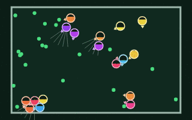
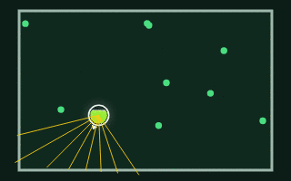
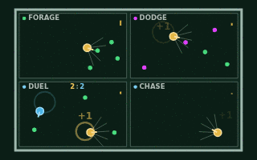
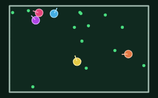
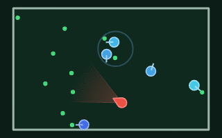

# Evolve World AI

  
  
  
  

  
  
  
  
  

  
  
  

<h3 align="center"><a href="https://erikfransson.github.io/evolve-world-ai/">Open Evolve World →</a></h3>

Creatures with small neural-network brains evolve in your browser: press Start and watch them learn to find food, dodge, hunt and share a world.

<table align="center">
  <tr>
    <td align="center" colspan="2"> <a href="https://erikfransson.github.io/evolve-world-ai/live/"><b>Live World</b></a></td>
  </tr>
  <tr>
    <td align="center"> <a href="https://erikfransson.github.io/evolve-world-ai/trials/"><b>Trials</b></a></td>
    <td align="center"> <a href="https://erikfransson.github.io/evolve-world-ai/arena/"><b>RL Arena</b></a></td>
  </tr>
  <tr>
    <td align="center"> <a href="https://erikfransson.github.io/evolve-world-ai/ecosystem/"><b>Ecosystem</b></a></td>
    <td align="center"> <a href="https://erikfransson.github.io/evolve-world-ai/predators/"><b>The Great Hunt</b></a></td>
  </tr>
</table>

## Repo structure
* `src/typescript/` web app and simulation (Vite + TypeScript), one HTML page per mode
  * `index.html` landing page, `trials/`, `ecosystem/` and `predators/` (The Great Hunt, the Ecosystem page script in predators mode), `arena/` (RL Arena: design, train and watch creatures), `live/` placeholder
  * `src/sim/` simulation; `creature.ts` (body, brain, senses) and `world.ts` (items, rays) are shared by modes
  * `src/sim/species.ts` species of a Great Hunt world (own body ranges, costs, births and diet); the Ecosystem is the one-species case
  * `src/sim/rl/` RL environments, evolution strategies learner and creature library. `src/rlTrain.ts` and `src/rlBench.ts` are its command-line entry points
  * `src/worker/` simulation workers and helpers; `renderWorker.ts` draws the Ecosystem on an OffscreenCanvas, fed snapshots by the simulation worker. It is on where the browser supports it, and the page draws instead when it is not (or with `?offscreen=0`)
  * `src/trials.ts`, `src/ecosystem.ts` (also the Great Hunt page), `src/landing.ts`, `src/arena.ts` one entry script per page
  * `src/sim/wasm/` optional WebAssembly SIMD kernels (brain forward, one-call sense); `.wat` sources are assembled into `kernels.generated.ts` with `npm run wasm` (wabt), and a test fails if they drift
  * `public/pool.json` Ecosystem seed pool: 300 Trials-trained founders picked for diversity from two `node src/buildPool.ts` sweeps and the earlier pool; the file's `command` field holds the recipe (each sweep about 3 h on 6 threads)
  * `public/coi-serviceworker.js` self-unregistering stub, kept at the old URL because visitors may still have the retired shared-memory service worker installed; on its next update check it removes itself and reloads their pages once. Nothing registers it any more, so it can be deleted once old installs are unlikely
* `src/python/` planned analysis of headless run output (empty so far)
* `docs/` for e.g. adr documents, and planning etc
* `tests/` tests for all code

## What this is
A live evolution simulation that runs in the browser: press Start and watch creatures evolve.
The same TypeScript simulation also runs headless (Node) for batch runs, to be analysed in Python (planned).

